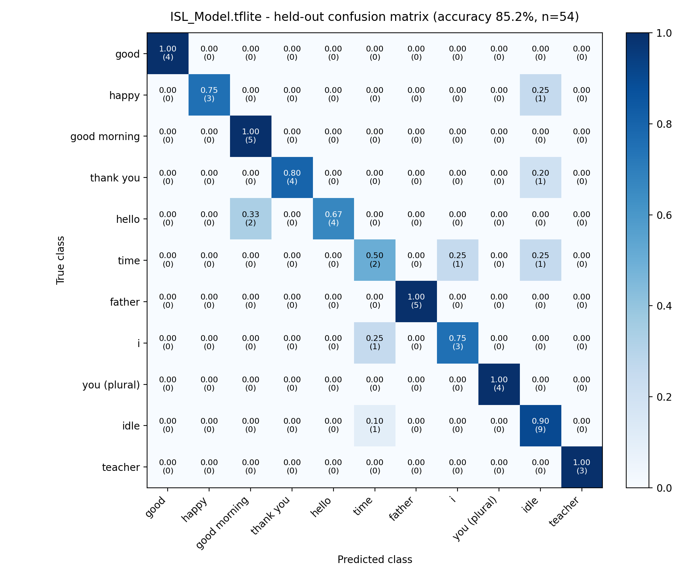

# Dual-Mode Hand Gesture Interface for Computer Control & Indian Sign Language (ISL)

> **TL;DR:** An open-source, CPU-only assistive computer vision system that runs a touchless virtual mouse (HCI) and isolated Indian Sign Language (ISL) gesture recognition with temporal sentence buffering from a single 640×480 webcam. Built for consumer Apple Silicon (ARM64) hardware with zero-copy multiprocessing (**30 FPS**, up from 14 FPS single-threaded), evaluated with 5-fold stratified cross-validation (**72.7% ± 4.1% accuracy, 0.73 macro-F1** across 532 clips / 11 classes), and backed by **52 hardware-free `pytest` unit tests**.

| Specification                | Verified Value                                                                                                       |
| :--------------------------- | :------------------------------------------------------------------------------------------------------------------- |
| **Author**                   | Satyam Chaudhary ([ORCID: 0009-0004-0677-1495](https://orcid.org/0009-0004-0677-1495))                               |
| **Publication**              | Presented at **AdcomSys 2026 (Springer)** — UEM Kolkata (Paper ID 307, First Author)                                 |
| **Core Stack**               | Python 3.10, MediaPipe Holistic, TensorFlow Lite (Bi-LSTM, ~159K params), OpenCV, PyAutoGUI, Eel                     |
| **Post-Paper Extension**     | Temporal Intelligence Engine + Hybrid LLM (**Apple MLX** `Qwen1.5-1.8B-Chat-4bit` + **Groq** `llama-3.1-8b-instant`) |
| **Throughput**               | **30 FPS** locked via zero-copy shared memory (author-measured; up from 14 FPS GIL-blocked baseline)                 |
| **ISL Accuracy (5-Fold CV)** | **72.74% ± 4.06%** accuracy, **0.726 ± 0.041** macro-F1 (532 clips, 11 classes, 150 epochs)                          |
| **Shipped `.tflite` Split**  | **85.19%** (46/54 clips), **0.859** macro-F1 on a single stratified 10% split (95% CI ≈ 73–92%)                      |
| **Unit Tests**               | **52 passing** (`pytest -v` — normalization invariances, One Euro Filter, intent routing, train/serve parity)        |
| **Target Hardware**          | macOS Apple Silicon (ARM64), standard consumer webcam, no GPU or depth sensor                                        |

---

## What Problem Does This Solve?

Existing assistive gesture systems face two structural bottlenecks:

1. **Functional Split:** Tools provide either deterministic OS navigation (virtual mouse) or sign language recognition—rarely both on a standard laptop.
2. **The Python GIL Bottleneck:** Running MediaPipe landmark extraction and Bi-LSTM deep learning inference in a single Python loop causes thread contention, dropping throughput to **14 FPS** and stuttering the cursor.

---

## System Architecture (AdcomSys 2026 Core + Phase 3 Extension)

<p align="center">
  
</p>

To stay within the **33.3 ms/frame** budget for 30 FPS, the system decouples webcam capture from AI inference across three OS processes:

- **Zero-Copy Shared Memory (GIL Bypass):** Standard `multiprocessing.Queue` pipes pickle and serialize each 640×480×3 frame (~27.6 MB/s at 30 FPS). Instead, `src/vision_backend.py` writes raw NumPy arrays directly into `multiprocessing.shared_memory` (`jarvis_shm`) via `numpy.copyto()`, giving the HCI and ISL consumer processes $O(1)$ zero-copy reads.
- **Single-Pass Holistic Extraction:** MediaPipe Holistic extracts 21-point dominant-hand landmarks (Mode 1 HCI) and a 201-point upper-body + dual-hand spatial vector (Mode 2 ISL) in one pass.
- **Post-Paper Extension (Phase 3):** Extends the published dual-mode core with a temporal state machine and a 3-tier translation pipeline (deterministic rule parser → local 4-bit Apple MLX → Groq LPU cloud fallback).

| Module                              | Responsibility                                                                                          |
| :---------------------------------- | :------------------------------------------------------------------------------------------------------ |
| `src/Jarvis.py`                     | Main orchestrator, process lifecycle, Eel Web GUI bridge, voice/text fallback                           |
| `src/vision_backend.py`             | 30 FPS webcam producer, zero-copy shared memory writer, wake/mode-switch heuristics                     |
| `src/controllers/HCI_Controller.py` | 21-point hand heuristics, One Euro Filter, relative-motion cursor & OS actions                          |
| `src/controllers/ISL_Controller.py` | 201-point Holistic extraction, Shoulder-Invariant Normalization, TFLite Bi-LSTM, temporal state machine |
| `src/controllers/llm_engine.py`     | Non-blocking Hybrid LLM worker (Apple MLX 4-bit local + Groq API failsafe, 5.0s timeout)                |
| `tests/test_core.py`                | 52 hardware-free unit tests (normalization, filters, `parse_intent`, train/serve skew guard)            |

---

## Verified Benchmarks & Evaluation

All ML metrics below are reproducible via `scripts/evaluate_tflite.py` and `scripts/cross_validate.py`.

### 1. Throughput: GIL-Blocked vs. Zero-Copy Multiprocessing

<p align="center">
  
</p>

### 2. ISL Recognition Evaluation (532 Curated Clips, 11 Classes)

Evaluated on **532 curated video sequences** (merged from INCLUDE-50 subsets and custom webcam captures) across 11 classes (`Hello`, `Thank You`, `Good Morning`, `Good`, `Happy`, `Time`, `Father`, `Teacher`, `I`, `You (plural)`, and 101 `Idle` negative-control clips):

| Evaluation Protocol                           |      Accuracy      |     Macro-F1      | Notes                                                                                                |
| :-------------------------------------------- | :----------------: | :---------------: | :--------------------------------------------------------------------------------------------------- |
| **5-Fold Stratified CV (Headline)**           | **72.74% ± 4.06%** | **0.726 ± 0.041** | Every clip tested once; folds: 70.1%, 76.6%, 74.5%, 67.0%, 75.5% (`scripts/cross_validate.py`)       |
| Shipped `ISL_Model.tflite` (Single 10% Split) |   85.19% (46/54)   |       0.859       | Reproducible held-out split (`scripts/evaluate_tflite.py`); 95% CI ≈ 73–92% (favourable draw vs. CV) |

_Note: 5-fold CV across 80, 100, and 150 epochs scored 72.4%, 71.8%, and 72.7% respectively—confirming performance is bounded by dataset size/diversity rather than training length._

<p align="center">
  
</p>

_Figure: Held-out confusion matrix of the shipped `models/ISL_Model.tflite` on the single 10% split (46/54 correct, showing row recall and raw clip counts)._

### 3. Temporal State Machine & Hybrid LLM Extension (Phase 3)

Raw sliding-window LSTM outputs flicker during hand transitions. The temporal engine applies a **0.80 / 0.70 hysteresis confidence gate**, leaky 5-frame `deque` majority vote (`popleft`), **0.5s word-hold confirmation**, **2.0s cooldown**, **0.8s post-word stability**, **3.0s–6.0s context-aware timeouts**, and a **10-frame Idle commit**. Short canonical phrases resolve deterministically via `parse_intent()`; multi-word gloss arrays route to the non-blocking Hybrid LLM worker.

<p align="center">
  
  &nbsp;&nbsp;&nbsp;
  
</p>

---

## Technical Deep Dive (Expandable)

<details>
<summary><strong>1. Mathematical Foundations (Shoulder-Invariant Normalization & One Euro Filter)</strong></summary>

- **Shoulder-Invariant Normalization (`src/utils/normalization.py`):** Centers all 201 landmark coordinates on the thoracic midpoint (`c = (S_L + S_R) / 2`) and scales by inter-acromion distance (`D = ||S_L - S_R||_2`, falling back to `1.0` if `D < 0.01`), followed by `nan_to_num` and `clip(-5.0, 5.0)` at both training and inference. Proven invariant to uniform scaling and translation by `tests/test_core.py`:

```math
\hat{x}_i = \frac{x_i - c}{D}, \quad D = \|S_L - S_R\|_2
```

- **One Euro Filter (`src/utils/math_utils.py`):** Speed-adaptive first-order low-pass filter (`min_cutoff = 0.01`, `beta = 1.0`, `d_cutoff = 1.0`) that suppresses slow hand tremors while lowering lag during fast sweeps:

```math
\alpha(f_c, \Delta t) = \frac{2\pi f_c \Delta t}{2\pi f_c \Delta t + 1}, \quad f_c = f_{\min} + \beta |\hat{\dot{x}}|, \quad \hat{x}_i = \alpha x_i + (1 - \alpha)\hat{x}_{i-1}
```

</details>

<details>
<summary><strong>2. Bi-LSTM Architecture, Training Recipe & Dataset Distribution</strong></summary>

- **Input Tensor:** `(1, 30, 201)` — 30 linearly interpolated frames × (75 upper-body pose + 63 left-hand + 63 right-hand 3D coordinates).
- **Network (~159K parameters):** `Bidirectional(LSTM(64, return_sequences=True, unroll=True))` → `BatchNorm` → `Dropout(0.3)` → `LSTM(32, unroll=True)` → `BatchNorm` → `Dropout(0.3)` → `Dense(32, ReLU)` → `Dense(11, Softmax)`.
- **Training & Export (`notebooks/train_isl_bilstm.ipynb`):** Adam (`lr=0.0005`, `clipnorm=1.0`), Sparse Categorical Cross-Entropy, 150 epochs, batch size 8. Exported to **TensorFlow Lite (Float32, builtin ops)** with `unroll=True` for Apple Silicon stability.

<p align="center">
  
</p>

<p align="center">
  
  &nbsp;&nbsp;&nbsp;
  
</p>

</details>

<details>
<summary><strong>3. HCI Gesture Controls & ISO 9241-9 Fitts' Law Pilot (n = 1)</strong></summary>

| OS Command             | Gesture              | Geometric State Logic                                                          |
| :--------------------- | :------------------- | :----------------------------------------------------------------------------- |
| **Cursor Move**        | Index up             | Relative knuckle (`lm 5`) delta × `1.3` (trackpad-style, prevents Gorilla Arm) |
| **Left / Right Click** | Index / Middle pinch | Euclidean distance `< 0.04` with `> 0.06` mutual-exclusion margin              |
| **Drag & Drop**        | Closed fist          | All four fingers curled (`mouseDown`, release on open)                         |
| **App Switch**         | Three fingers        | Index, middle, ring up; pinky down (`⌘-Tab`, 1.0s cooldown)                    |
| **Screenshot**         | Pinky up             | Pinky extended only (`⌘⇧3`, 1.0s cooldown)                                     |
| **Neutral / Clutch**   | Open hand            | Pauses cursor to reposition hand                                               |

**Single-User Fitts' Law Pilot (n = 1, CMU HCII Instrument):**

- Standard GUI targets (`W = 1.00 cm, D = 4.0 cm`): **418.7 ms movement time, 0% error**.
- Sub-pixel targets (`W = 0.25 cm, D = 4.0–8.0 cm`): 60–90% error (640×480 webcam resolution floor).

</details>

<details>
<summary><strong>4. Hybrid LLM Fault Tolerance (`src/controllers/llm_engine.py`)</strong></summary>

- **3-Tier Routing:** `parse_intent()` (0 ms deterministic templates) → local **Apple MLX** (`mlx-community/Qwen1.5-1.8B-Chat-4bit`, ~1.2 GB RAM) → **Groq** (`llama-3.1-8b-instant`) fallback, live-switchable via `data/llm_mode.txt`.
- **Guardrails:** Non-blocking background worker thread, strict **5.0s `ThreadPoolExecutor` timeout**, 2-attempt Groq retry (0.5s backoff), tuple-keyed result cache, and capitalised raw-gloss fallback.

</details>

---

## Known Limitations & Honest Engineering Audit

Full source-level audit documented in [`PROJECT_DEEP_DIVE.md`](PROJECT_DEEP_DIVE.md):

- **Per-Class CV Weak Spots:** Pooled 5-fold CV F1 is lowest on `good` (0.57), `you (plural)` (0.63), `hello` (0.67), and `idle` (0.68; ~66% recall, meaning ~1 in 3 idle clips classifies as a sign before temporal gating). Strongest classes: `father` (0.90) and `happy` (0.88).
- **Evaluation Scope:** Clip-level stratified split (not signer-disjoint) on 532 clips from 11 classes; Fitts' Law pilot is n = 1.
- **Live Pipeline Caveats:** `vision_backend.py` sets `frame_ready` without clearing per frame (allowing consumers to free-run on shared memory) and applies `cv2.flip(frame, 1)` live while training clips were unflipped.
- **Platform Scope:** OS bindings (`osascript`/⌘ hotkeys) and Apple MLX target macOS ARM64; Linux/Windows ports require swapping to `xdotool`/`pywin32` and the Groq/CPU backend.

---

## Quick Start & Testing (macOS Apple Silicon)

```bash
git clone [https://github.com/Nittaany/dual-mode-gesture-isl.git](https://github.com/Nittaany/dual-mode-gesture-isl.git)
cd dual-mode-gesture-isl
python3.10 -m venv venv && source venv/bin/activate
pip install -r requirements.txt
cp .env.example .env   # optional: add GROQ_API_KEY for cloud fallback
python3 src/Jarvis.py
```

### Run Unit Tests & Reproducible Evaluation

```bash
pip install -r requirements-dev.txt
python -m pytest -v                 # 52 hardware-free tests (~0.2s)
python scripts/evaluate_tflite.py   # requires local data/processed/X.npy
python scripts/cross_validate.py    # 5-fold stratified CV
```

- **Hands-Free Controls:** Hold **Thumbs-Up (2.0s)** to wake · Hold **Open Palm (3.5s)** to toggle HCI ↔ ISL.
- **Dataset Note:** Raw INCLUDE-50 videos and `data/processed/X.npy` are excluded from git due to size and dataset licensing.

---

## Citations & License

- **Paper:** S. Chaudhary, A. Goyal, and C. Venkatesh, _"Webcam-Based Dual-Mode Hand Gesture Interface for Computer Control and Indian Sign Language,"_ presented at the **Third International Conference on Advanced Computing and Systems (AdcomSys 2026)**, Springer / UEM Kolkata, June 26–27, 2026 (Paper ID 307).
- **Base Dataset:** A. Sridhar, R. G. Ganesan, P. Kumar, and M. Khapra, _"INCLUDE: A Large Scale Dataset for Indian Sign Language Recognition,"_ ACM Multimedia (MM '20), 2020.
- **License:** Released under the [MIT License](LICENSE).
